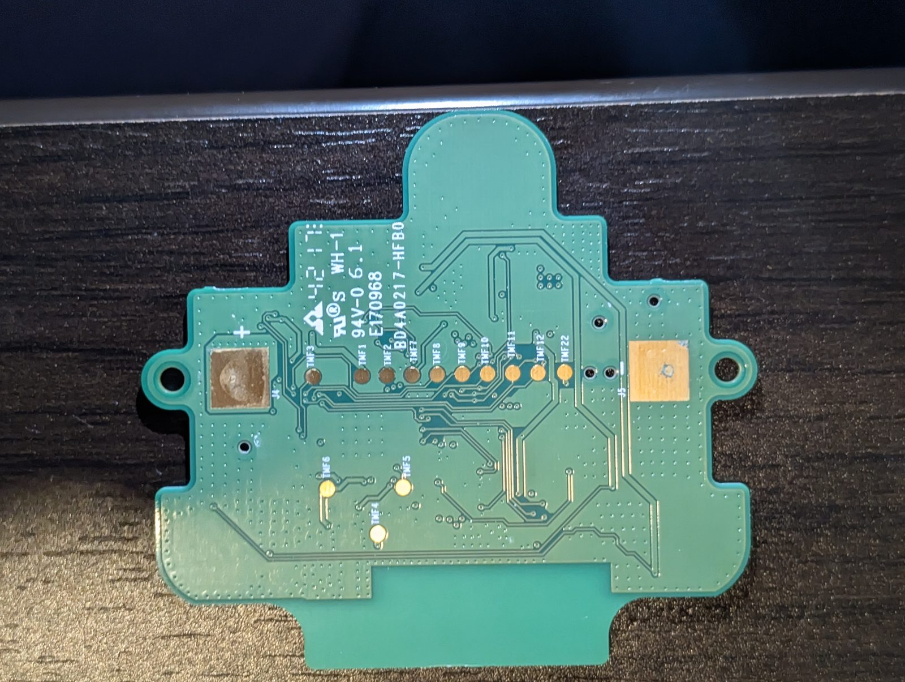
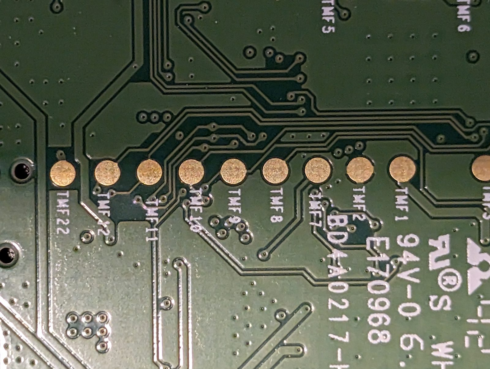
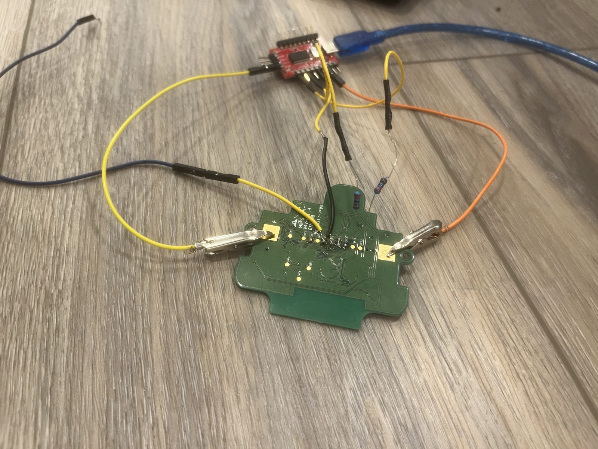
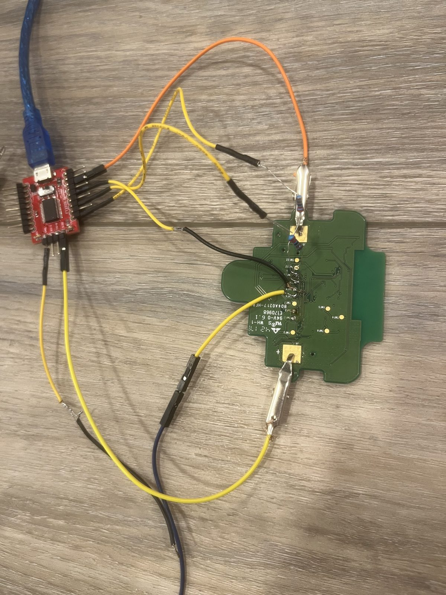
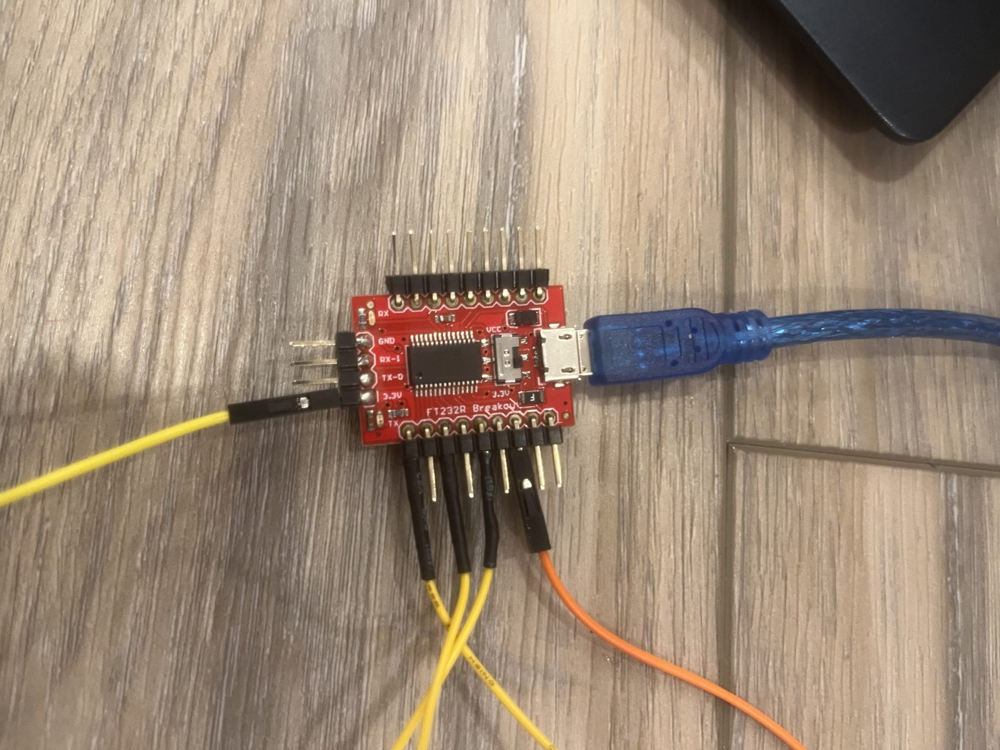
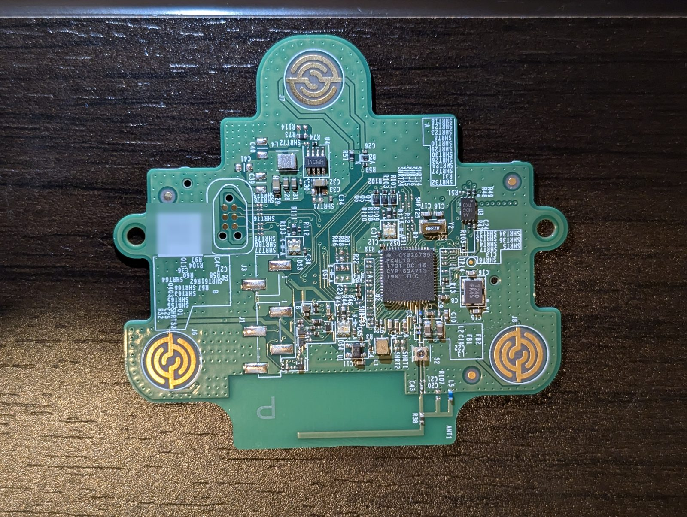
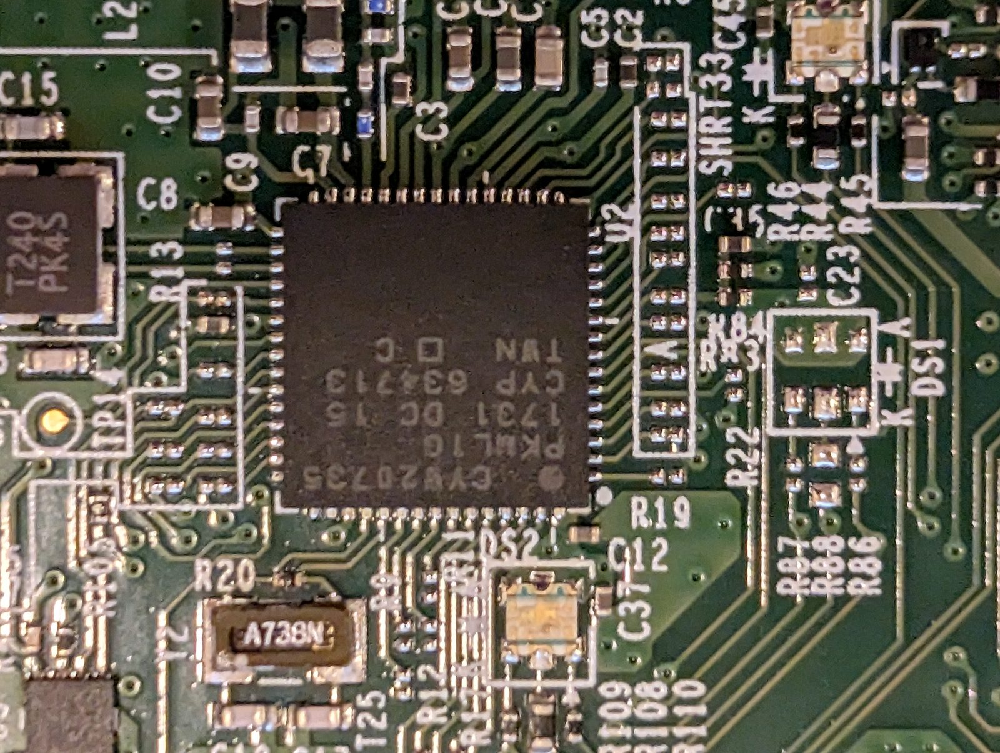
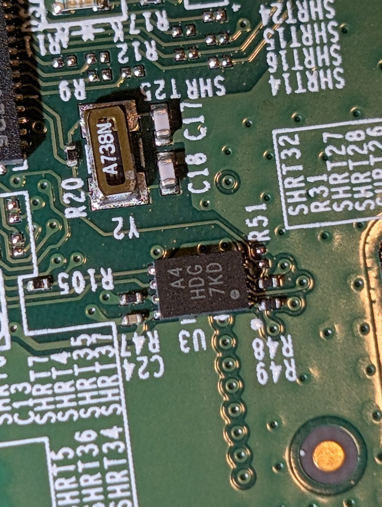
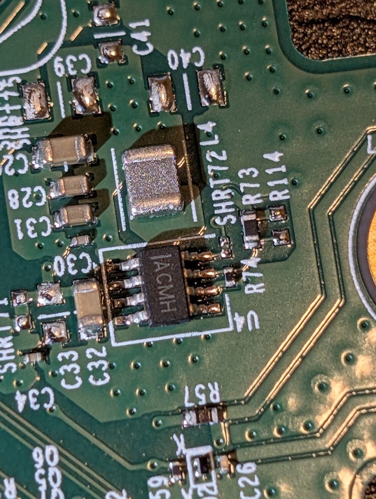

# Echo Button: wiring, flashing and setup guide

A complete, hands-on procedure for putting **AButton** (the open firmware in this folder) on
an Amazon Echo Button, getting it into Home Assistant, updating it, and recovering a unit
that won't boot. It needs no build environment: ready-made images are in
[`prebuilt/`](prebuilt/). Background and chip details: [`../research/firmware_access.md`](../research/firmware_access.md).

> **Two paths.** On its **stock** firmware the button works with this repository's Home
> Assistant integration over Classic Bluetooth, with no soldering (see the main README).
> **AButton** needs a one-time wired flash, then reports presses as BTHome over BLE (so
> ESPHome Bluetooth proxies work), never sleeps, and updates over the air.

> **No warranty.** Opening, wiring and reflashing a button is entirely at your own risk. The maintainer is not responsible for bricked, broken or unflashable buttons, or any other damage, however it happens.

### Which way to update a button

How you write firmware depends on what the button runs **now**. The fiddly 2-second press
windows are only for a button whose firmware is **bad**; a working button is easy:

| The button runs | How to update it | Effort |
|---|---|---|
| **Stock firmware** (works normally) | the UART flasher, step 4 | press once; the stock firmware keeps the board on for 10 minutes, and the flash takes about 25 s |
| **AButton** (works normally) | **over the air**, step 6 | no wires, no presses: about 100 s over Bluetooth |
| **AButton**, with your own image or key | the UART flasher in **flash mode**, step 6b (0.2.1, experimental) | hold the button 8 s at power-up, then about 25 s |
| **Bad firmware**: no LED, no adverts, dies about 2 s after every press | the UART flasher in press windows, step 7 | about 15 presses, each giving a 2 s window |

"Bad" means the firmware doesn't start or doesn't hold the power on, for example after an
interrupted or wrong flash. Only then does the chip fall back to the ROM's download mode for
the 2 s each press powers the board. (A running AButton refuses the UART flasher with `0x0C`
unless it is in flash mode, step 6b.)

## Rules that keep a button recoverable

1. **Never write flash sector 0** (`0x0000`–`0x0FFF`). It holds the unit's BD_ADDR, radio
   calibration and serial numbers; nothing else can restore them. The flasher refuses it.
2. **Never send `0xFFCE` (Chip_Erase).** It erases sector 0 too.
3. **Dump the whole flash before the first write**, and keep it private (it also holds the
   button's pairing keys).
4. **3.3 V logic only**, and **never power the board from the adapter**: it runs on its
   batteries.
5. **Run the flashing tools on a real Linux host, not in a VM.** Every power-up of the
   button re-enumerates the USB-serial adapter, and VM USB pass-through usually loses it
   for good.

## What you need

- An Echo Button, model **H5V83Y**, **board revision 1** (byte `0xC20` of the flash is `1`;
  check your dump in step 3). Rev-2 boards aren't supported.
- A **3.3 V USB-serial adapter** with an RTS output (FT232RL boards with a 3.3 V/5 V jumper
  work; set it to 3.3 V).
- Two **1 kΩ resistors** (recommended, for the adapter's TXD and RTS lines).
- Thin wire (30 AWG wire-wrap or similar), a fine-tip soldering iron, flux, Kapton tape, and
  a 4-pin header or plug so the button can be connected and disconnected.
- A Linux PC with Python 3: `pip install pyserial bleak cryptography`. A Bluetooth LE adapter
  for over-the-air updates and checks (any BlueZ adapter).
- Fresh AAA cells.

## 1. Solder the UART lead

The test pads **TMF1–TMF22** are on the side of the PCB that faces the battery compartment
(the side with the battery contacts J4 `+` and J5 `−`). The photos show a rev-1 board out of
its case.



The row, left to right in this view: TMF3, TMF1, TMF2, TMF7, TMF8, TMF9, TMF10, TMF11,
TMF12, TMF22; TMF4–6 are the three pads below it (not used). Each pad is labelled:



You need four of them:

| Pad | Signal | Connect to |
|---|---|---|
| **TMF2** | GND | adapter GND |
| **TMF9** | chip TXD (out) | adapter RXD |
| **TMF11** | chip RXD (in) | adapter TXD, through 1 kΩ |
| **TMF10** | chip CTS_N (in) | adapter RTS, through 1 kΩ |
| TMF1 | 3.3 V | **leave unconnected** |

```
 adapter (3.3 V)                       Echo Button test pads
 ───────────────                       ─────────────────────
 GND  ───────────────────────────────► TMF2   GND
 RXD  ◄─────────────────────────────── TMF9   chip TXD
 TXD  ──────────[ 1 kΩ ]─────────────► TMF11  chip RXD
 RTS  ──────────[ 1 kΩ ]─────────────► TMF10  chip CTS_N
                                       TMF1   3.3 V   (not connected)
```

Soldering tips:
- Tin each pad and each wire end first, then touch them together for a second. The pads are
  small; too much heat lifts them.
- Put the resistors in the lead (at the plug end), not on the PCB.
- Tape the wires down with Kapton next to the pads so a tug can't rip a pad, and route them
  out so the battery cover still closes (or leave it off while working).
- Check with a multimeter: no short between any two of the four wires.

The finished rig (a SparkFun FT232R breakout set to 3.3 V, the four wires soldered to the
pad row with the 1 kΩ resistors in the TXD and RTS leads; this board is out of its case and
fed through clip leads on its battery contacts):



|  |  |
|---|---|
| the whole rig | the adapter end |

[`images/recovery.mp4`](images/recovery.mp4) (2.5 min, no sound) shows a **recovery** of a
unit with bad firmware, in press windows: each touch of the wake wire powers the board for
about 2 s while the flasher works, until the LED lights up on the restored firmware. A
working button doesn't need this (see "Which way to update a button" above).

For orientation, the other side: the CYW20735 SoC in the middle, the serial flash U3
(right of the crystal), the boost converter U4 (top), the SWD footprint J2 (the 2×3 holes,
left), the RGB LEDs (DS1–DS4) and the three gold button-switch pads.



|  |  |  |
|---|---|---|
| CYW20735 (`PKML1G`), crystal Y2, LED DS2 | serial flash U3 (Adesto AT25SF041, 512 KiB) | boost converter U4 |

Optional, **untried**: a momentary switch from **TMF8** (SPI MOSI) to GND. Held during a
press, it keeps the ROM from reading the flash, which forces its download handler. It's an
escape hatch for a unit whose firmware boots but blocks the UART; see "Recovery" below.

## 2. Check the connection

Insert the batteries, plug in the adapter, and find its port (`ls /dev/ttyUSB*`; you may need
to be in the `dialout` group). Then:

```sh
python3 research/echobtn_trace.py --port /dev/ttyUSB0 --seconds 60
```

Press the button. On stock firmware you'll see an adapter re-enumeration (`serial dropped …
reopening`) and then plain-text debug lines from the button, such as
`hci_connect_hid_device, current hid state = 3`. Nothing at all: swap TXD/RXD and check GND.

## 3. Back up the flash

Press the button once (stock firmware stays awake for 10 minutes), then:

```sh
mkdir -p dump
python3 research/echobtn_hci_dump.py --port /dev/ttyUSB0 --read 0xFF000000 0x80000 dump/sflash.bin
python3 research/echobtn_hci_dump.py --port /dev/ttyUSB0 --read 0xFF000000 0x80000 dump/sflash2.bin
cmp dump/sflash.bin dump/sflash2.bin && sha256sum dump/sflash.bin
python3 firmware/abutton_image.py show dump/sflash.bin     # MAC, serial
python3 -c "print('board revision', open('dump/sflash.bin','rb').read()[0xC20])"   # must be 1
```

The two reads must be identical. Note the **16-character serial** (e.g. `G090XX…`); the
flasher checks it. If every read returns status `0x0C`, the stock firmware is busy (usually
trying to reconnect to its Echo): switch that Echo off, take the batteries out for 10 s,
press once and retry.

## 4. Flash AButton

> **About the signing key.** The prebuilt image trusts only the repository maintainer's key:
> over the air, the button accepts **only** updates the maintainer signs and publishes here.
> The prebuilt images (0.2.1 and later) include a UART flash mode (step 6b) meant for flashing your
> own builds onto a running AButton later, but it's untested over the UART so far. To be
> safe, [build from source](#building-your-own) now and flash your own image here if you
> want your own key.

```sh
python3 research/echobtn_resume_flash.py firmware/prebuilt/abutton-0.3.0.bin \
    --sectors 0x1000,0x4000-0x1e000 --expect-serial <your serial>
```

What happens:
- It checks the chip answers, brings up flash access, and **aborts unless the unit's serial
  matches**, before writing anything.
- Each 4 KB sector is compared first and skipped if it already matches; otherwise erased,
  written and read back. Sector `0x1000` is erased so the unit boots this bank (see OTA below).
- **One press is enough.** The stock firmware keeps the board powered for 10 minutes after
  a press, and the whole flash takes about 25 s, so it finishes in one go; no press windows.
  If the stock firmware is busy and refuses (`0x0C`, e.g. while it tries to reconnect to its
  Echo), switch that Echo off, take the batteries out for 10 s, press once and run it again.
- Progress is kept in `<image>.state`, so an interrupted run resumes; use `--fresh` after
  you've flashed anything else to the unit.
- Sectors 0, `0x2000` and `0x3000` are never touched: the unit keeps its MAC, calibration and
  factory data, and AButton names itself like stock (`EchoBtn` + the serial's last 3 characters).

Then take the batteries out for a few seconds, put them back, and **press once**. The LED
blinks green (amber or red if the batteries are low), then stays dark; it lights white while
the button is held.

**Debug build:** `abutton-0.3.0-dbg.bin` prints a heartbeat, button and battery traces on the
UART (read them with `echobtn_trace.py`). Use it for bring-up; keep the trace reader running
while it's in use.

## 5. Check it and add it to Home Assistant

```sh
python3 firmware/abutton_ble.py monitor                 # BTHome adverts, decoded
```

Expect a line per event, e.g.
`EchoBtnABC rssi -52 {'packet_id': 4, 'battery': 100, 'button': 'press'}`.
Single, double and triple clicks give `press`, `double_press`, `triple_press`; holding for
1 s gives `long_press` (`long_double_press`, `long_triple_press` after 1 or 2 clicks).

Home Assistant picks the button up twice, through the host's Bluetooth adapter or any
ESPHome Bluetooth proxy in range (Settings → Devices & services → Discovered):

- **BTHome** (built in): the button event entity and the battery sensor.
- **Amazon Echo Button** (this repository's integration, 0.2.0+): the **LED** as a `light`
  entity, `echo_button.play_animation` (with `repeat: 0` to loop until the light is changed),
  an **Identify** button, and the button's settings under **Configure** (LED brightness, color
  while held, click timing, advert interval, low-battery level and warning, battery color on
  power-up, keep the LED color across restarts). It finds AButtons by the service UUID in
  their scan response, so a proxy has to be in **active** mode, and connects only to send
  changes.

Both attach to the same device. Example automation (use your button's entity ids):

```yaml
automation:
  - alias: AButton double press toggles the hall light
    triggers:
      - trigger: state
        entity_id: event.echobtnabc_button
    conditions:
      - condition: state
        entity_id: event.echobtnabc_button
        attribute: event_type
        state: double_press
    actions:
      - action: light.toggle
        target: { entity_id: light.hall }
  - alias: AButton glows amber while the garage is open
    triggers:
      - trigger: state
        entity_id: cover.garage_door
    actions:
      - if: "{{ trigger.to_state.state == 'open' }}"
        then:
          - action: light.turn_on
            target: { entity_id: light.echobtnabc_led }
            data: { rgb_color: [255, 140, 0], brightness: 120 }
        else:
          - action: light.turn_off
            target: { entity_id: light.echobtnabc_led }
```

Ready-made animations to start from (Aurora, Rainbow, Breathe, Police, Doorbell):
[`../examples/animations.yaml`](../examples/animations.yaml), Home Assistant scripts that ask
which button to play on.

Without Home Assistant, `firmware/abutton_ble.py` does the same from a shell (`color`,
`animate`, `config`, `name`, `identify`; see [`README.md`](README.md#configure-a-button-from-the-command-line)).

No command line? The **web page** in [`../web/`](../web/) does the same from Chrome or Edge
over Web Bluetooth. Serve it over HTTPS (the repository's GitHub Pages) or locally with
`python3 -m http.server -d web` and open `http://localhost:8000`.

A unit that was paired with the stock firmware's Classic Bluetooth integration can be removed
from it; AButton doesn't use Classic Bluetooth.

### Encrypt the presses (0.3.0+)

BTHome adverts are plain by default: anyone nearby can see the presses, and could send fake
ones to trigger your automations. To encrypt them:

1. **Press the button once.** It only accepts a key change within 60 seconds of a press.
2. On the web page, click **Turn on encryption**, or run
   `python3 firmware/abutton_ble.py key AA:BB:CC:DD:EE:FF --generate`. The button blinks green
   twice, and you get the key (32 hex characters). Save it; the button never shows it again.
3. In Home Assistant, the BTHome integration asks for the key within a minute
   (Settings → Devices & services). Paste it there.

A new key works the same way. To go back to plain adverts, press the button, turn encryption off
(two amber blinks), then delete the button's BTHome device in Home Assistant and add it again:
BTHome ignores unencrypted adverts from a device it has a key for.

## 6. Update over the air

Once a button runs AButton, **every update goes this way**: no wires, no presses, nothing
opened. The serial lead is only needed again if a button ends up with bad firmware (step 7).

```sh
python3 firmware/abutton_ble.py info AA:BB:CC:DD:EE:FF                 # firmware version
python3 firmware/abutton_ble.py ota  AA:BB:CC:DD:EE:FF firmware/prebuilt/abutton-0.3.0.ota.signed
```

- About 100 s for 80 KB (0.8 KiB/s). The LED is dim blue during the transfer. The button
  checks the signature, switches banks and resets; it comes back by itself.
- **Signing:** a button running the prebuilt image only accepts updates signed with the
  maintainer's key, i.e. the `.ota.signed` files published in `prebuilt/`. Your own builds
  won't install on it. A button flashed with your own build accepts only images signed with
  your key. The key is fixed at the first (UART) flash; see the note in step 4.
- A running AButton refuses the UART flasher (it answers `0x0C`) unless it's in flash mode
  (step 6b).
- If BlueZ fails with `br-connection-create-socket`, it remembers the button as a Classic
  device from the stock firmware: `bluetoothctl remove AA:BB:CC:DD:EE:FF`, then retry.
  A plain `error:` is usually a connection timeout; retry once.

## 6b. Wired flash of a running AButton: flash mode (0.2.1, experimental)

> **Status:** in firmware 0.2.1 (the prebuilt images). Verified: the 8 s hold and the
> magenta LED. **Not yet tested:** flashing over the UART in this mode. Expect to fall back
> to step 7 if it doesn't work.

For a button that runs AButton but should get an image you can't send over the air: your
own build (another signing key), a debug build, or stock. Needs the UART wiring from step 1.

1. Take the batteries out for a few seconds and put them back (or cut the rig's power).
2. **Press and hold the button for 8 s**, until the LED turns **magenta**, then let go. The
   button now stops Bluetooth and opens its HCI UART to the flasher; it stays powered.
3. Then run the flasher exactly as in step 4, e.g.
   `python3 research/echobtn_resume_flash.py IMAGE --sectors 0x1000,0x4000-0x1e000 --expect-serial <serial> --fresh`.
   It reports `Chip already answering READ_RAM` and runs in one go.
4. Take the batteries out and back in, and press: the new image boots.

Letting go before 8 s just boots normally. Nothing in flash mode is reachable over the air.

## 7. Recovery (only for bad firmware): a unit that dies about 2 s after each press

**Skip this step for a working button.** Stock firmware is flashed with one press (step 4)
and AButton is updated over the air (step 6). You only need press windows when the firmware
on the button is bad.

Symptoms: no LED, no adverts; it answers on the UART only right after a press. The firmware
doesn't start or doesn't hold the power on (for example after an interrupted or wrong flash),
and the ROM's download handler runs for the ~2 s each press powers the board. The same
flasher works in those windows:

```sh
python3 research/echobtn_resume_flash.py IMAGE --sectors 0x1000,0x4000-0x1e000 --expect-serial <serial>
```

Press when it says `Press the button`, release when it reports the window closed, repeat:
about 15 presses for 27 sectors (1–2 sectors fit in each 2 s window). Progress survives between presses. Then take the batteries
out for a few seconds and press.

IMAGE is `firmware/prebuilt/abutton-0.3.0.bin` (or your own build) for AButton, or your own
dump (`dump/sflash.bin`) for stock.

If the flasher says the firmware refuses vendor commands (`0x0C`), the unit runs a working
AButton: update it over the air, or put it in flash mode first (step 6b). A unit whose firmware boots but neither answers nor
works needs the untried TMF8 trick (step 1).

## 8. Back to stock

Flash your own dump (`dump/sflash.bin`, step 3) with `--sectors 0x1000,0x4000-0x1e000`:
- on a unit running **AButton 0.2.1**: in flash mode, as in step 6b (experimental);
- on a unit stuck in the ROM handler: in press windows, as in step 7.

Without a dump: a stock firmware image of a rev-1 unit (the firmware sectors only, no unit
data) is available from the maintainer on request; it isn't published here, as it's
Amazon's.

After restoring stock, pair it with the Home Assistant integration as in the main README.

## Troubleshooting

| Symptom | Cause, fix |
|---|---|
| No traces or replies at all | TXD/RXD swapped, no common GND, adapter at 5 V, or the button is off (press it) |
| Port disappears on every press | normal (back-feed re-enumerates the adapter); the tools reopen it. In a VM it may not come back: use a real host |
| Every command gets `0x0C` | stock is busy (power-cycle, press, retry) or AButton is running (use OTA) |
| Flash reads `0x12` | the ROM handler before flash detection; the flasher handles it (a no-op write first) |
| Unit dies 2 s after each press | the firmware doesn't start or doesn't latch P5: recovery (step 7) |
| Battery % doesn't change | it's only measured while the LED is dark; a constantly lit LED freezes it |
| No "Amazon Echo Button" discovery for an AButton | the proxy must be in active mode (scan responses) |
| `br-connection-create-socket` (CLI or Home Assistant) | BlueZ still has the stock firmware's Classic pairing for the button. The integration (0.2.1+) removes it by itself; on the command line, `bluetoothctl remove <MAC>` |

## Building your own

See [`README.md`](README.md#build): WICED Studio 6.0 with the B0 platform
(`research/install_wiced_b0_sdk.sh`), then `firmware/build.sh` (`TRACE=1` for a debug build).
Your build creates its own OTA signing key at `~/.config/abutton/ota_key.pem`; back it up and
never publish it. `firmware/abutton_image.py assemble firmware/out/abutton.hex -o unit.bin`
turns the build into a flashable image.
